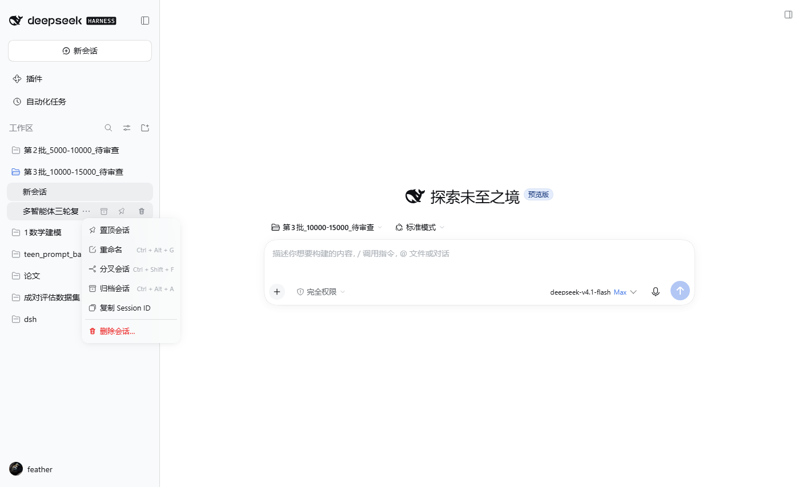
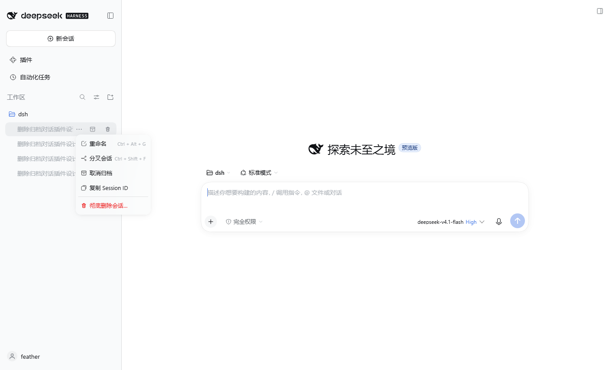
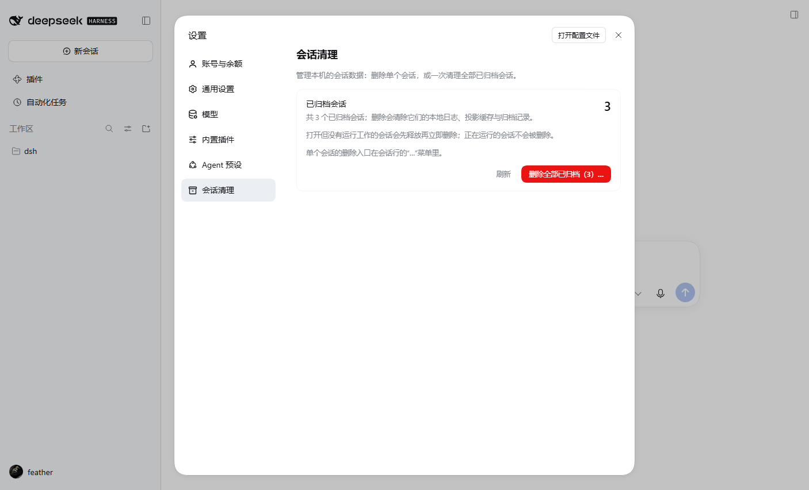
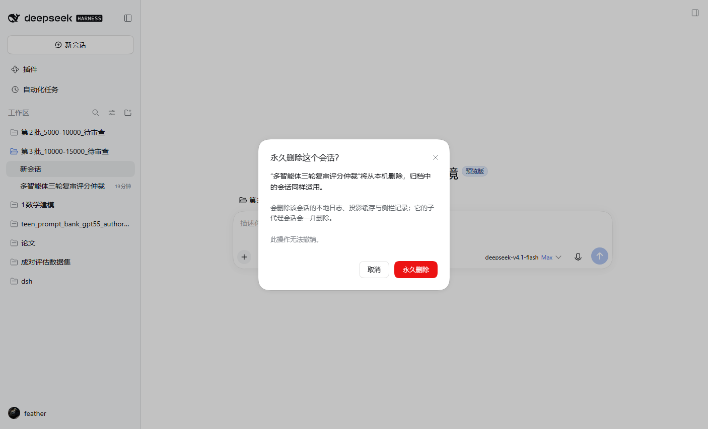
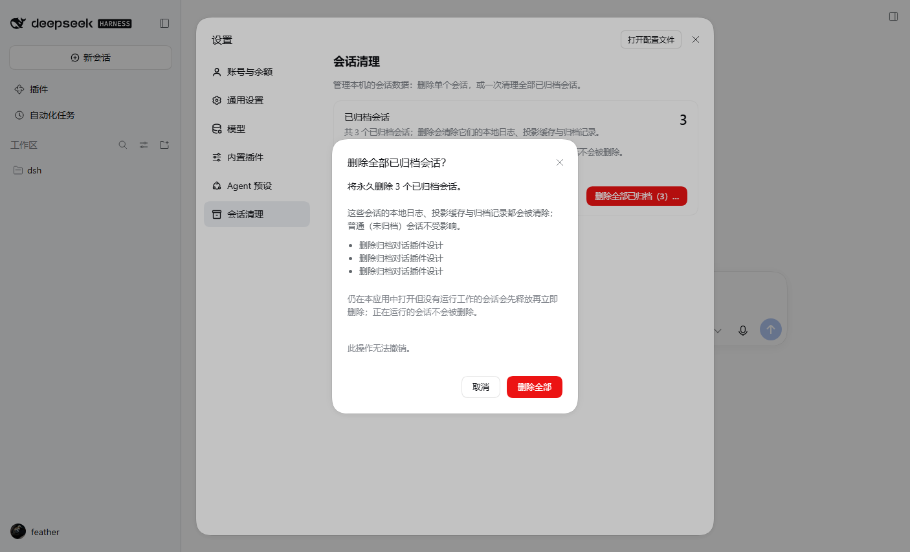
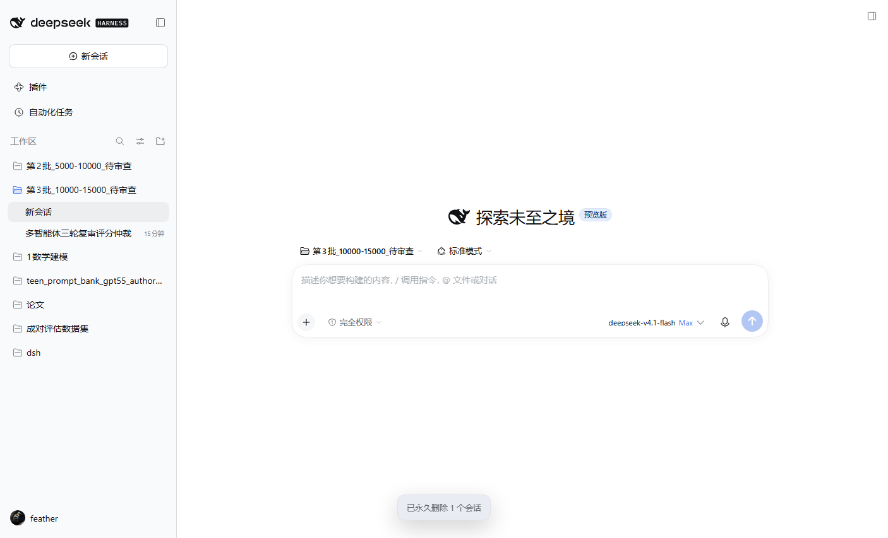

# dsh-session-cleaner · delete conversations and purge archived ones

A durable DeepSeek Harness Web plugin (bundle) that adds the one destructive
maintenance capability DSH deliberately leaves out: **deleting a stored
conversation**, archived or not, and **deleting every archived conversation in
one confirmed action**.

DSH only ships archive/unarchive: archiving hides a conversation from grouping
surfaces while its log, projection cache and archive record remain on disk.
The persistence seam documents "no delete or retention interface"; pruning
stored sessions is out-of-band backend maintenance. This bundle is that
controlled out-of-band entry point.

## Screenshots





**Delete all archived** lives in **Settings → Conversation cleanup**, together
with the archived count and pending-queue status:







## What it adds

| Entry | Where | Behavior |
|---|---|---|
| Delete conversation… | Last row item in every conversation `…` menu | Destructive confirmation, then permanent deletion |
| Trash hover button | Right side of every conversation row (archived rows too) | Same, one click shorter |
| Delete all archived (N)… | **Settings → Conversation cleanup** | Confirms and deletes **all archived conversations**; ordinary conversations untouched |

Deletion is permanent and has no undo.

## What is deleted

For each conversation, the Host half removes:

1. the session-owned JSONL log directory under `$DSH_HOME/sessions/<project>/<id>/`;
2. the derived projection-cache record `$DSH_HOME/storages/session_projcache/sessions/<id>.json` (title, turn outline, token stats, cached projection values) plus `.bak.*`;
3. Workspace-registry references — archive set, pin set and each Workspace's ordered `sessionIds` — through the public `ctx.workspaceRegistry` service, never by rewriting `workspace.json` behind a running process;
4. subagent descendant conversations (headers with `origin: 'subagent'` whose ancestry reaches the deleted session), so no hidden orphan data is left behind.

The SQLite FTS search index reconciles deleted sources on its next search.
Attachments are content-addressed and deduplicated across conversations, so
they are intentionally not removed.

## Live, running and forked conversations

DSH's **fork** creates its child through `ctx.agents.create()` but discards the
returned `AgentHandle`. The forked child therefore stays a *live* Session in the
Host process — with its JSONL write handle open — until the process exits. That
is why older builds had to queue forked conversations for deletion at the next
start.

The current flow:

- **A conversation with running work** (active turn, subagents, background jobs,
  active schedules): refused and counted in the result, so executing work is
  never silently truncated.
- **A live but idle conversation** (typically a forked child, or one archived
  moments ago): the Host detaches it through the SessionStore / AgentRegistry
  detach primitives. That emits `session/disposed`, closes the persistence
  write handle and lets the projection cache write its final checkpoint; the
  cache is purged again after it settles, then the log, cache and Workspace
  references are removed immediately.
- **The currently open conversation**: the browser half opens a new
  conversation first (`uiWorkspace.startSession()`), then the same deletion
  runs. A second window showing that conversation is invalidated by the delete.
- Only when this runtime exposes no working detach primitive, or the Session is
  still held afterwards, does the id fall back to
  `$DSH_HOME/session-cleaner/pending.json` for the next-start sweep.

Result after deleting a freshly forked child (deleted immediately, row gone,
pending queue empty):



## Architecture

### Host half (`index.js`)

- Injects `webServer`, `sessions`, `sessionPersistence`, `workspaceRegistry`.
- Mounts a prefix route on the existing Web server:
  - `POST /session-cleaner/api/status` → `{ archived, pending, lastSweep }`.
  - `POST /session-cleaner/api/probe` → per-Session `{ live, agent, activity, dir, known, canDetach }` diagnostics.
  - `POST /session-cleaner/api/delete` → `{ ids: [...] }` or `{ scope: 'archived' }`, returning per-session status plus count buckets. Idle live Sessions are detached and deleted immediately; `deferLive: true` restores the old next-start queue behavior.
  - `POST /session-cleaner/api/sweep` → retry the pending queue now and return the per-Session results.
- The route carries the same browser-trust fence as the `/api` gateway
  (loopback/trusted Host, refuses `Sec-Fetch-Site: cross-site`, same-origin
  Origin). It is a DNS-rebinding / cross-site defense, not authentication.
- Session ids are allow-listed and escaped with the JSONL backend's own
  `encodeSegment`; log directories are discovered by scanning project folders,
  never by trusting a caller-supplied path.
- Every mutation (deletion, queue write, sweep) is serialized; queue and
  diagnostic files are replaced atomically (temp file + rename).
- 800 ms after boot the Host sweeps the pending queue and records the outcome
  in `$DSH_HOME/session-cleaner/last-sweep.json`.

### Browser half (`client.js`)

- Pure browser plugin, no new dependencies; uses platform `react` and the
  optional `@deepseek-ai/dsh-client-ui-primitives` (with fallbacks when absent).
- Registers four extension points:
  - `sidebar.workspaces.session.menu.item` — delete conversation (order 500,
    destructive, separator);
  - `sidebar.workspaces.session.row.action` — trash hover button (order 300);
  - `settings.section` — the “Conversation cleanup” page (id
    `archived-sessions`, order 40), with the archived count, pending-queue
    status, a refresh action and the one-click **Delete all archived** button;
  - `shell.overlay` — confirmation dialog and result toast.
- The archive set and titles are derived from
  `uiWorkspace.workspaces.list` / `uiWorkspace.sessions.list`; no second copy
  of that state is kept.
- After deletion it calls `ctx.sessions.refresh()`, so the row disappears
  immediately without a page reload.

### Why not edit JSON directly

`workspace.json` and the projection cache are live domain state. Mutating them
behind the running services would fork memory from disk and be overwritten by
the next write. The plugin removes only session-owned on-disk artifacts (the
log directory and the per-record projection-cache document) and performs every
registry change through public services.

## Install

Link the bundle into the active profile (here `desktop`; use `web` for a Web
deployment):

```powershell
cd C:\Users\<you>\.dsh\profiles\desktop
pnpm add link:E:/dsh/session-cleaner
```

Then append `dsh-session-cleaner` to that profile's
`dsh.profile.bundles` list and let HMR recompose (or restart). The plugin
manager page lists it as “Conversation Cleanup”.

## Optional configuration

The defaults follow the standard `$DSH_HOME` layout. Only relocate the paths
when the profile moves the JSONL store or projection cache:

```yaml
- id: session-cleaner
  name: 'dsh-session-cleaner'
  config:
    sessionsRoot: 'D:\dsh-data\sessions'
    projectionCacheRoot: 'D:\dsh-data\storages\session_projcache\sessions'
```

## Known limitations

- No undo or recycle bin: permanent deletion after explicit confirmation.
- An idle live conversation is detached before deletion; another window
  viewing it is invalidated. A residual loop object may log diagnostics, but
  it cannot restore the deleted data.
- Running conversations are refused; stop or archive them first.
- Attachment objects are not removed (shared, content-addressed).
- The SQLite search index reconciles automatically; telemetry and other
  external stores are out of scope.
- The default path discovery assumes the shipped per-project JSONL layout;
  other backends need equivalent maintenance or the path overrides above.

## Verify

```powershell
cd E:\dsh\session-cleaner
node test/host-smoke.mjs     # fence, single/batch deletion, cascade, deferral, active refusal, boot sweep
node test/client-smoke.mjs   # slot registration, menu/button/dialog rendering, request bodies, refresh, errors
```

Both smoke tests run the real files against temporary directories and never
touch user session data.

The bundle was additionally verified against the live Desktop Host:

- the fenced `status` route returned the real archive set, and deleting a
  temporary parent + subagent-child pair through `delete` removed both log
  directories while leaving the archive set unchanged;
- **fork fix**: forking an existing conversation through the real GUI and then
  deleting the forked child through the row menu deleted it immediately — the
  row disappeared, the log directory and projection cache were gone, and the
  pending queue stayed empty. Before the fix that child was reported as
  “queued for the next start”;
- **backlog sweep**: five forked conversations left in the queue by the old
  build were detached and deleted by the next sweep; `last-sweep.json` recorded
  five `deleted` results, the archive count dropped from 7 to 3, and neither
  the Workspace registry nor the projection cache kept a reference;
- a headless Edge session authenticated with a minted browser cookie loaded the
  real GUI: the conversation menu, **Settings → Conversation cleanup** and both
  confirmation dialogs rendered and closed on cancel (see `docs/`);
- HMR mounted the updated Host route, sweep logic and browser bundle without
  restarting the Desktop application.
